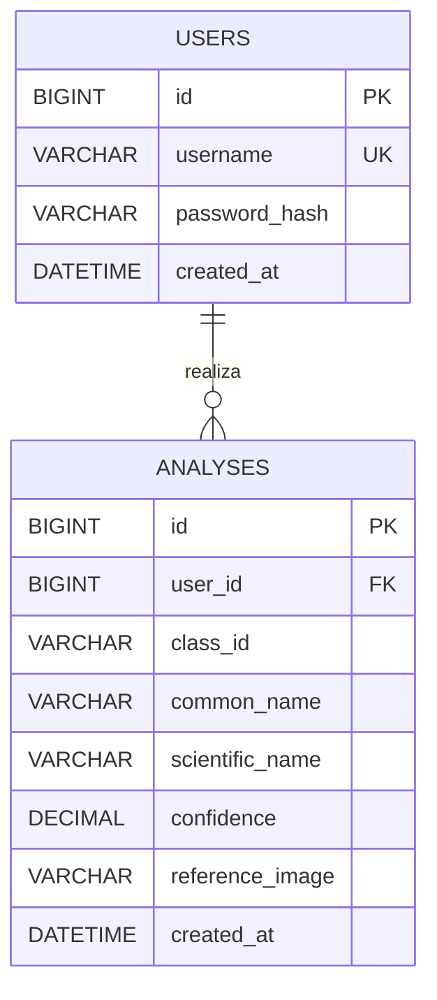

# LEAFVISION — Arquitectura de la base de datos

## Entidades

La base de datos contempla dos tablas relacionadas:

- **`users`**: almacena los datos de acceso y registro de cada usuario.
- **`analyses`**: almacena las identificaciones de plantas realizadas correctamente.

La relación es **1:N**: un usuario puede tener varios análisis y cada análisis pertenece a un único usuario.

## Esquema relacional

## Criterios de almacenamiento

- Solo se insertan registros en `analyses` cuando la respuesta del servidor contiene **`success = true`**.
- Las consultas fallidas no se almacenan en esta tabla.
- Cada análisis se asocia al usuario autenticado mediante `user_id`; el historial debe mostrar únicamente los análisis de ese usuario.
- `confidence` representa la confianza de la inferencia en el intervalo de 0 a 1.
~~- `reference_image` guarda una referencia o nombre de archivo, no la imagen binaria.~~
- `created_at` registra la fecha y hora del registro.

## Seguridad

Las contraseñas no se almacenan en texto plano. Se debe guardar un hash generado con un algoritmo específico para contraseñas.

## Flujo de persistencia

1. El usuario se registra o inicia sesión consultando `users`.
2. El cliente Java envía una imagen al servidor Python.
3. Si la respuesta indica `success = true`, Java guarda los campos de identificación en `analyses`.
4. Si la respuesta indica `success = false`, no se crea un registro de análisis.
