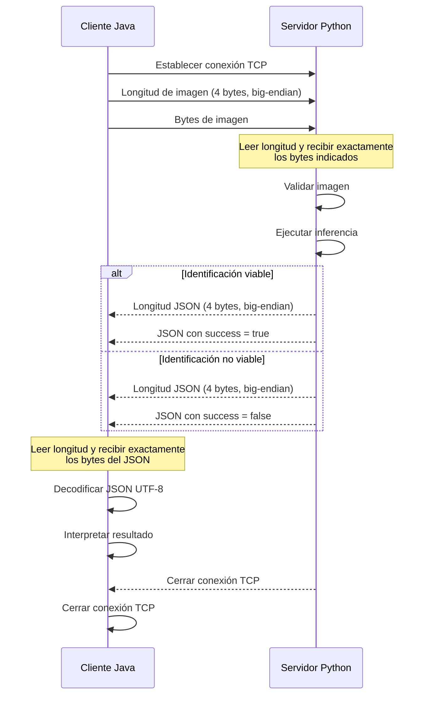

# LEAFVISION --- Especificación de comunicación TCP

## 1. Objetivo

Definir el protocolo de comunicación entre la aplicación de escritorio
Java y el servidor local Python para el envío de imágenes y
la recepción del resultado de identificación.

## 2. Modelo de comunicación

La comunicación utilizará TCP. Cada conexión transportará una única solicitud y una única respuesta.

El intercambio seguirá esta secuencia:

1.  El cliente Java envía la longitud de la imagen.
2.  El cliente Java envía los bytes de la imagen.
3.  El servidor Python procesa la imagen.
4.  El servidor Python envía la longitud de la respuesta JSON.
5.  El servidor Python envía el JSON codificado en UTF-8.
6.  Ambos extremos cierran la conexión.



## 3. Formato de los mensajes

Cada mensaje está compuesto por un **prefijo de longitud de 4 bytes**, seguido de su contenido.

| Campo | Especificación |
|---|---|
| Prefijo de longitud | Entero sin signo de 4 bytes, *big-endian* (orden de red). |
| Solicitud | Bytes originales de la imagen. |
| Respuesta | JSON codificado en UTF-8. |
| Delimitación | La longitud prefijada determina el tamaño exacto del contenido. |


## 4. Solicitud: imagen

El cliente enviará los bytes originales del archivo de imagen, sin
codificación Base64.

La imagen deberá cumplir los requisitos funcionales del proyecto:

-   Formato JPG o PNG.
-   Tamaño máximo de 10 MB.

El servidor deberá leer exactamente la cantidad de bytes indicada por el
prefijo y validar la imagen.

## 5. Respuesta: JSON

### 5.1. Identificación viable

``` json
{
  "success": true,
  "class_id": "species_001",
  "common_name": "Nombre común",
  "scientific_name": "Nombre científico",
  "confidence": 0.94,
  "reference_image": "species_001.jpg"
}
```

### 5.2. Identificación no viable

``` json
{
  "success": false,
  "error": "LOW_CONFIDENCE",
  "message": "No ha sido posible identificar la planta."
}
```

### 5.3. Semántica de los campos

 | Campo | Tipo | Descripción |
|---|---|---|
| `success` | Booleano | Indica si la identificación es válida. |
| `class_id` | Cadena | Identificador de la clase identificada. Presente cuando `success` es `true`. |
| `common_name` | Cadena | Nombre común de la especie. |
| `scientific_name` | Cadena | Nombre científico de la especie. |
| `confidence` | Número | Confianza de la predicción, entre `0.0` y `1.0`. |
| `reference_image` | Cadena | Identificador o nombre de la imagen de referencia. |
| `error` | Cadena | Código de error. Presente cuando `success` es `false`. |
| `message` | Cadena | Mensaje comprensible asociado al resultado o error. |

Los campos de identificación (`class_id`, `common_name`,
`scientific_name`, `confidence` y `reference_image`) se incluirán cuando
`success` sea `true`. En caso contrario, se incluirán `error` y
`message`.

## 6. Códigos de error

| Código | Descripción |
|---|---|
| `LOW_CONFIDENCE` | La confianza de la predicción no supera el umbral establecido. |
| `INVALID_IMAGE` | La imagen no es válida o no puede decodificarse. |
| `UNSUPPORTED_FORMAT` | El formato de imagen no está admitido. |
| `IMAGE_TOO_LARGE` | La imagen supera el tamaño máximo permitido. |
| `INTERNAL_ERROR` | Se ha producido un error interno durante el procesamiento. |

Los códigos son valores estables destinados a la interpretación por
parte del cliente de la conexión. El texto de `message` está destinado a la
presentación al usuario.

## 7. Reglas de lectura y validación

-   El receptor deberá leer exactamente los 4 bytes del prefijo antes de
    interpretar la longitud.
-   El receptor deberá leer exactamente el número de bytes indicado para
    completar el mensaje.
-   No se asumirá que una única operación de lectura TCP devuelve todos
    los bytes solicitados.
-   La longitud deberá validarse antes de reservar memoria o leer el
    contenido.
-   El JSON se codificará y decodificará utilizando UTF-8.
-   Si la conexión se interrumpe antes de recibir el mensaje completo,
    la operación se considerará fallida.
-   El cliente establecerá un tiempo máximo de espera para la respuesta.
-   El servidor enviará una única respuesta y cerrará la conexión.

## 8. Compatibilidad de implementación

Para mantener la compatibilidad entre Java y Python:

-   En Java, `DataOutputStream.writeInt()` y `DataInputStream.readInt()`
    utilizan un entero de 4 bytes en big-endian.
-   En Python, `struct.pack("!I", length)` y `struct.unpack("!I", data)`
    representan un entero sin signo de 4 bytes en big-endian.


## 9. Alcance

Esta especificación define el intercambio de una imagen por conexión TCP
y la recepción de una respuesta JSON. No contempla autenticación TCP,
conexiones persistentes, procesamiento de varias solicitudes en una
misma conexión ni cifrado de transporte. Estos aspectos quedan fuera del
protocolo inicial y no se prevee su implementación en el proyecto. Quedaria por tanto para una posible futura revisión.
